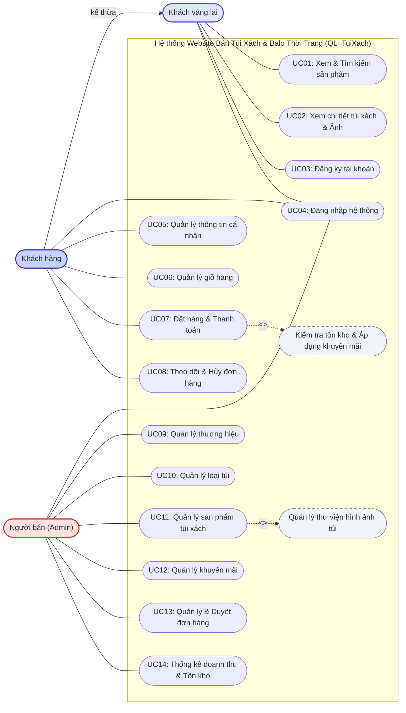

# ĐỒ ÁN LẬP TRÌNH WEB - SHOP TÚI XÁCH & BALO THỜI TRANG BASAU 👜

Website thương mại điện tử chuyên kinh doanh các sản phẩm túi xách thời trang cao cấp (**BaSau Bags Store**), được phát triển trên nền tảng **ASP.NET Core 8 MVC** và **Entity Framework Core**.

## 🎯 Sơ Đồ & Đặc Tả 14 Use Case Nghiệp Vụ (`QL_TuiXach`)

Hệ thống được thiết kế theo chuẩn UML Use Case Diagram gồm **3 Tác nhân (Actors)** và **14 Use Case**:

### Bảng Mô Tả Chi Tiết 14 Use Case:
| Mã UC | Tên Use Case | Tác nhân chính | Quan hệ phụ thuộc | Mô tả nghiệp vụ |
| :---: | :--- | :--- | :---: | :--- |
| **UC01** | Xem & Tìm kiếm sản phẩm | Khách vãng lai, Khách hàng | - | Lọc theo thương hiệu, loại túi, mức giá và tìm kiếm theo từ khóa. |
| **UC02** | Xem chi tiết túi xách & Ảnh | Khách vãng lai, Khách hàng | - | Xem thông tin chi tiết, giá ưu đãi, tồn kho và thư viện ảnh nhiều góc độ. |
| **UC03** | Đăng ký tài khoản | Khách vãng lai | - | Tạo tài khoản thành viên mới để mua hàng và tích lũy lịch sử. |
| **UC04** | Đăng nhập hệ thống | Khách vãng lai, Khách hàng, Admin | - | Xác thực danh tính bằng Cookie Authentication, phân quyền vai trò (`Người bán`, `Khách hàng`). |
| **UC05** | Quản lý thông tin cá nhân | Khách hàng | - | Cập nhật họ tên, số điện thoại, địa chỉ nhận hàng và đổi mật khẩu. |
| **UC06** | Quản lý giỏ hàng | Khách hàng | - | Thêm túi vào giỏ, cập nhật số lượng (kiểm tra tồn kho), xóa từng món hoặc làm trống giỏ. |
| **UC07** | Đặt hàng & Thanh toán | Khách hàng | `<<include>>` Kiểm tra tồn kho & Áp dụng khuyến mãi | Chọn địa chỉ (kèm toạ độ bản đồ Leaflet), chọn phương thức (COD/Chuyển khoản), tính tiền tự động. |
| **UC08** | Theo dõi & Hủy đơn hàng | Khách hàng | - | Xem tiến trình giao hàng qua thanh Shopee Stepper; được phép hủy đơn khi trạng thái là `Chờ duyệt`. |
| **UC09** | Quản lý thương hiệu | Người bán (Admin) | - | Thêm, sửa, xóa các thương hiệu đối tác (CHARLES & KEITH, Pedro, ELLY...). |
| **UC10** | Quản lý loại túi | Người bán (Admin) | - | Quản lý danh mục phân loại túi xách (Balo, Túi đeo chéo, Túi tote...). |
| **UC11** | Quản lý sản phẩm túi xách | Người bán (Admin) | `<<include>>` Quản lý thư viện hình ảnh túi | Thêm mới, cập nhật giá, tồn kho sản phẩm kèm bộ sưu tập ảnh chi tiết. |
| **UC12** | Quản lý khuyến mãi | Người bán (Admin) | - | Thiết lập các đợt giảm giá, phần trăm chiết khấu và thời gian áp dụng Flash Sale. |
| **UC13** | Quản lý & Duyệt đơn hàng | Người bán (Admin) | - | Xem danh sách đơn, duyệt đơn từ `Chờ duyệt` sang `Đang giao` hoặc `Hoàn tất` (đồng bộ Stepper). |
| **UC14** | Thống kê doanh thu & Tồn kho | Người bán (Admin) | - | Báo cáo doanh số bán lẻ, số lượng đơn hoàn tất và cảnh báo sản phẩm sắp hết hàng. |

---

## 🛠️ Công Nghệ & Kỹ Thuật Nổi Bật

- **Nền tảng:** C# / .NET 8 (ASP.NET Core MVC).
- **ORM & CSDL:** Entity Framework Core 8 (Code-First với Auto-Migrations & Seeder), SQL Server.
- **Background Worker & Channels:** `System.Threading.Channels` kết hợp `IHostedService` (`OrderEmailQueue`) giúp gửi thư SMTP không làm chậm luồng thanh toán của khách.
- **Email Service:** MailKit & MimeKit, bảo mật thông tin bằng `.env` và mã hóa chống XSS/Phishing bằng `WebUtility.HtmlEncode`.
- **Giao tiếp Real-time:** SignalR WebSocket cho hỗ trợ chat khách - nhân viên (`SupportChatHub`) và cập nhật đơn hàng.
- **Bản đồ số:** Leaflet OpenStreetMap ghim vị trí giao hàng chính xác, lưu tọa độ vào `localStorage`.
- **Đồ họa 3D:** Google `<model-viewer>` hiển thị mô hình túi xoay 360° tương tác định dạng `.glb`.
- **Kiến trúc Code Clean:** Chuẩn hóa hằng số `AppConstants`, tách biệt mã JavaScript (`hot-marquee.js`, `flashsale-banner.js`) và CSS (`site.css`).

---

## 🚀 Hướng Dẫn Chạy Dự Án

### Cách 1: Chạy mạng LAN để test trên điện thoại thật (Khuyên dùng)
1. Kết nối máy tính và điện thoại vào **cùng một mạng Wi-Fi**.
2. Nhấp đúp chuột vào file **`chay-lan.bat`** ở thư mục gốc.
3. Script sẽ tự động tìm IP LAN thật (bỏ qua mạng ảo) và cổng trống.
4. Màn hình console sẽ in ra đường dẫn, ví dụ:  
   👉 **`http://192.168.1.15:5226`**
5. Lấy điện thoại mở trình duyệt gõ địa chỉ trên là bạn có thể test đầy đủ giao diện, đặt hàng và chat trực tiếp!

### Cách 2: Chạy thông thường trên máy tính
1. Nhấp đúp chuột vào file **`run.bat`** (hoặc mở solution trong Visual Studio 2022 và nhấn **F5**).
2. Trình duyệt sẽ tự động mở trang web tại địa chỉ:  
   👉 **`http://localhost:5226`**

